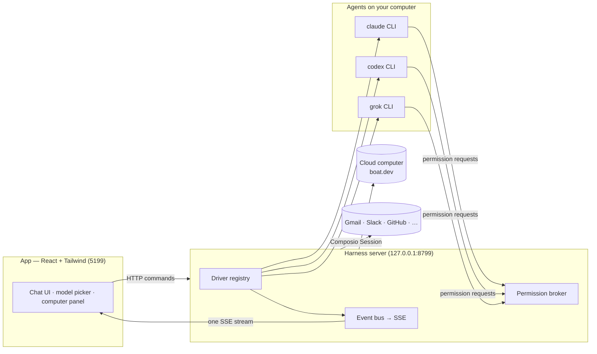

# GitHub 推荐：OpenMausBot 把 Claude Code 变成聊天同事，82 天拿下 10K stars

> GitHub: https://github.com/milind-soni/openmausbot

## 一句话总结

OpenMausBot 是一个把 `claude` / `codex` CLI 变成「聊天联系人」的本地优先 Electron 桌面应用——**每个 bot 是真的 agent**，有独立人格、独立模型、独立云电脑，**接的是你自己已经付费的订阅**；82 天做到 10,284 star、104 万行代码、7,524 个 commit，其中 52% 带 Claude 联合作者签名。

## 值得关注的理由

- **产品形态的首发者**：2026 年下半年 xAI Grok Bot、Meta Muse、OpenAI dots、Manus Cue 等闭源「AI 同事」在七周内密集发布，把「agent 该长成聊天软件而不是 IDE」这个判断第一次变成了市场共识。OpenMausBot 是这波里完成度最高的开源补位——也是唯一提供真实桌面发行物（macOS 签名公证 .dmg / Windows 安装器 / Ubuntu .deb + AppImage / iOS + Android companion）的那个。
- **一份罕见的「一个人 + AI agent 造产品」实录**：7,524 个 commit 里 3,942 个（52.4%）带 `Co-Authored-By: Claude ...` trailer，单日峰值 437 次提交中有连续 4 小时每小时 60+ 次落盘。作者把「AI 改 → agent 验证 → 人 review」制度化成流水线（`AGENTS.md` + 125 篇验证文档 + 三层行为评测），于是一个人的产出看起来像一支团队。
- **安全工程既是它最强的护城河，也是最大的窟窿**：Linux 打包器校验 SHA-256 + 成员白名单 + CycloneDX SBOM、Wayland 上 fail-closed 永不启动 Cua 驱动并主动清除历史 opt-in——这些在同类项目里罕见；但第三方审计指出「Auto」档会在 macOS/Windows 上直接接管你的真实桌面、Composio 工具绕过审批卡、loopback server 不认证调用方，**安全模型是「配置依赖」而非「构造安全」**。

## 项目展示

*主视觉：整个产品形态就是这个——左侧是 bot 名单（像联系人），右侧是它的对话。每个联系人背后跑着一个真实 CLI agent。*

*模型选择器带 provider 轨道：Claude 与 Codex 模型并排、默认值标记、不可用的 provider 连同原因一起变灰。可在对话中途切换。*

*bot-computer 面板：每个 bot 有自己的云端 Linux 桌面（Boat / 隔离 Local VM / 本机），可实时看画面并接管。*

*Allow / Deny 审批卡：permission broker 把 agent 的每一个危险动作变成一次人工确认——这是「本地优先」能成立的关键。*

> 在线预览（脚本化产品演示，非真实 agent 会话）：<https://mausbot.com/demo>

*README 内嵌架构图：App 端零 client-side transport，只发 HTTP 命令 + 收一条 SSE 事件流；所有 provider 的原生协议在本地 server 层被归一。*

## 项目画像

| 维度 | 数据 |
|------|------|
| GitHub | https://github.com/milind-soni/openmausbot |
| Star / Fork | 10,284 / 1,423（Fork/Star = 13.8%，异常高） |
| 代码行数 | 1,042,733（TypeScript 63.4%，JSON 18.8%，TSX 8.7%，JavaScript 6.9%） |
| 项目年龄 | 2.7 个月（2026-08-11 创建，2026-11-01 仍在推送） |
| 开发阶段 | 密集开发（近 30 天 4,163 个 commit，10 月环比 +98%） |
| 贡献模式 | 独立主导 + 核心少数 + 社区（主作者合并双 git 身份后占 57.0%，228 位提交者） |
| 热度定位 | 大众热门（细分赛道第一，大盘腰部） |
| 质量评级 | 代码优秀 · 文档优秀 · 测试充分（测试代码 44.6 万行 ≈ 生产代码 47.3 万行） |
| 许可证 | Apache 2.0（`enterprise/` 为 source-available 商业授权，open-core） |

## 作者视角：为什么存在这个项目

### 创始人/作者背景

Milind Soni（`milind-soni`），GitHub profile **完全空白**——bio、公司、位置、博客全是 null。276 个粉丝、145 个公开仓库、账号 7.8 年。OpenMausBot 在他最近活跃的仓库里排**第 1**，star 数是第二名的 15 倍。

真实背景藏在 `LICENSING.md` 里：「The OpenMausBot and MausBot names and the mascot are trademarks of **Supamaus Software Private Limited**」。作者人在越南，为项目建了一整条仓群——`openmausbot`（core）、`openmausbot-releases`（发行产物）、`openmausbot-teams`（团队模板市场）、`supamaus-releases`，外加付费托管 `cloud.openmausbot.com` 与 `enterprise/` 授权层，官网挂着 Nvidia Inception 徽章、Product Hunt 上榜（post_id 1271564）。

**最值得注意的一点是反差**：作者个人影响力（276 followers）与项目影响力（10k star）严重不匹配。这项目完全靠**产品形态和时机**起量，不靠作者个人 IP——这本身就是一个信号：它的 star 数是形态热度的函数，不是技术深度的函数。

### 问题判断

作者做的是**逆向设计**。2026 年下半年，闭源阵营七周内密集发布四款「AI 同事」产品，共同点是：模型、电脑、数据全锁在厂商那侧，单一模型绑定，封闭付费。OpenMausBot 官方专文《Why we built a chat app for AI agents instead of an IDE》把核心洞察讲得很直白——**管理一群人你用的是聊天软件，不是 IDE**。

作者看到的空白不是「再做一个 agent 框架」，而是**三件事的交集**：

1. **12+ 个 agent CLI 的协议碎片化**——Claude 用 stream-JSON、Codex 用 JSON-RPC、Grok 用 ACP，语义几乎无交集；
2. **权限模型只有两个极端**——要么全开（`bypassPermissions`），要么每步点确认，没有中间档；
3. **多订阅用户不愿为跑 agent 再付一次钱**——已有 Claude Pro、ChatGPT Plus、Cursor 的人想要的是「把我买过的东西跑起来」，不是「再买一个 agent 产品」。

### 解法哲学

明确的选择，同样重要的是**明确的不做**：

- **不代理 provider，直接跑本机 CLI**。这一条决定了整个产品形态：没有中间服务器、没有额外计费、复用你已有的登录态。反过来说，代价是产品的能力上限被上游 CLI 锁死。
- **不代理就不该代理模型层，所以把复杂度全压在「协议归一层」**。`server/contracts.ts` 的 `ProviderDriver` SPI 只有 6 个成员，加一个 provider = 一个文件 + 一行注册。
- **降级而非崩溃**。未知 driver 不报错，而是降级成保留配置的「影子快照」——配置文件转发到别的机器仍然可用。
- **可审计优于便利**。MCP server 刻意收窄到不暴露审批授权、删除、任意设置、凭据、电脑生命周期。
- **客户定制永不 fork**。这条写进了 `LICENSING.md`：客户特有的品牌、skills、连接器属于客户自己的仓库，以数据和配置的形式存在，而不是 fork。

最值得注意的是 `AGENTS.md`——这份 1.3KB 的文件可能是全仓库最值得单独读一遍的东西。它禁止「解释下一行在做什么」，禁止「记录历史（used to / PR 号 / 计划切片名：git 有）」，禁止「画横幅、留注释掉的代码」，并且给了一条判定准则：

> A rule（「never X」「must match Y」）belongs in a type, a test or a lint rule.

**而这份规约是被真遵守了的**——实测注释率仅 6.3%，正好压住了 AI 生成代码最典型的过度注释特征。

### 战略意图

这是**真 open-core，不是「假装 open-core」**。`enterprise/` 全部代码 713 行，但授权设计相当讲究：仅 5 个 entitlement id 且每个标注状态；**离线 Ed25519 签名**的 license key，公钥烘进二进制（「one build serves every customer」「Verification is offline; nothing phones home」）；删掉 `enterprise/` 目录剩下的代码仍能构建运行，有一个 `open-source edition builds without enterprise/` 的 CI job 专门证明这点。

`LICENSING.md` 里的分层规则比多数商业开源项目写得清楚：

> could any open-source user want it? → **core**，作为公开 PR
> Organisation-, admin- or tier-flavoured? → **enterprise/**，挂在 entitlement 后面
> Customer-specific brand, skills, packages or connectors → **客户自己的仓库**，作为数据和配置，永不 fork

所以**商业化路径是清晰的**：开源 core 获客 → 托管版（MausBox / cloud.openmausbot.com）吃「不想让笔记本一直开着」的用户 → enterprise 层吃组织级管控需求。开源不是慈善，是漏斗顶端。

## 核心价值提炼

### 创新之处

按「新颖度 × 实用性」排序：

1. **纯 TypeScript 手写 seccomp BPF 过滤器**（新颖度 3/5 · 实用性 4/5 · 可迁移性 4/5）
   不依赖任何原生模块，直接构造 `struct sock_filter` 字节流，拒绝 28 个 syscall，带架构守卫，**并自带 `simulate()` 解释器**——意味着 syscall 过滤逻辑可以脱离内核做单元测试。
2. **把安全策略表达成纯函数 + 差分安全测试**（4/5 · 5/5 · 5/5）
   挂载计划是一份 `Mount[]` 纯数据，配八个「移除一个保护」的 mutation 开关，每个测试断言「去掉它恰好打开它守的那个洞」。**把安全测试写成差分测试**——这是全仓库最值得抄的做法。
3. **Stable / Volatile 系统提示词切分以保住缓存前缀**（3/5 · 5/5 · 5/5）
   stable 部分保持字节一致以命中 provider 的 prompt cache，volatile 部分塞进最新 user message 或 CLI 的 `<system-reminder>` 约定，SHA-256 指纹落盘，并用 `reAnchorAfterTurns` 定期重锚应对「引擎重写历史但不发事件」。
4. **回答来源与动作批准来源分离**（4/5 · 5/5 · 5/5）
   permission broker 里只有 `source === "user"` 的答案才会被填进模型的 answers 字段，broker 自己的超时提示绝不能被模型读成「用户说了 yes」。**任何「LLM 等人」的异步审批流都会踩这个坑。**
5. **给模型看的 schema 与服务端校验用的 schema 分离**（3/5 · 5/5 · 5/5）
   MCP Gate 精确计算 Go `encoding/json` 的字节语义（`<>&` 六字节转义、U+2028/9 三字节）、处理 Kimi Code 先内联 `$ref` 的行为、删掉未引用的 `$defs`——**裁剪只影响给模型看的那一份，服务端仍用完整 schema 校验每次调用**。
6. **权限沿委派链「只升不降」传播**（4/5 · 4/5 · 4/5）
   Chief of Staff 把任务派给 teammate 时，沿 handoff 链（≤32 跳防环）查最近的 Chief，级别在分派时算一次并记录在 assignment 上，传递时留说明行。
7. **用 git blame 追溯 i18n 翻译时效性**（4/5 · 4/5 · 4/5）
   每条翻译记录它所依据的英文版本的 SHA-256；`--record-hashes` 通过 git blame 找到该翻译最后修改的 commit，取那个 commit 里的英文原文做哈希；哈希与今天的英文不匹配即判定 stale，`pnpm i18n:check` 直接失败。**PR 不改这个文件，只有 release bump 才提交——而且 CI 里绝不跑模型。**
8. **真实线程脱敏成可入库的测试资产**（4/5 · 5/5 · 5/5）
   Tier2 golden 评测把真实对话线程经脱敏流水线变成 fixture，配 trace baseline 重放与泄漏扫描——于是「用真实数据回归」和「真实数据不出仓库」两件事同时成立。

### 可复用的模式与技巧

| 模式 | 简述 | 适用场景 |
|------|------|---------|
| **能力位协商** | 用一组细粒度 optional flag 描述「怎么支持」而非「支持与否」，每条 flag 守一条「永远不告诉模型它做不到的事」的规则 | 多后端集成的 SPI 设计 |
| **影子降级** | 未知/无效的后端保留配置但降级为 unavailable 影子，不删不改 | 配置文件需跨机器、跨版本转发的系统 |
| **归一化保留 raw 逃生舱** | 判别联合事件流，每个事件可选携带原始协议帧——归一不等于信息销毁 | 多协议归一 |
| **永不挂死的异步等待** | 连接绑定请求，socket 掉线时 pending ask 立即 resolve 成一句「可行动的话」 | 任何跨进程审批流 |
| **给模型看的 vs 系统校验的** | schema / system prompt / 权限 / 凭据四层都做这个分离 | 任何 AI 代理系统 |
| **差分安全测试** | 每个保护一个 mutation 开关，测试断言「移除它恰好打开它守的洞」 | 隔离 / 沙箱 |
| **缓存前缀稳定性切分** | system prompt 拆 stable/volatile，volatile 走 user turn | 任何用 prompt cache 的应用 |
| **沿委派链传播的只升不降权限** | 级别在分派时算一次并记录在工单上 | 多 agent 编排治理 |
| **VCS 历史当翻译时效性真相来源** | git blame + 源文本 hash + release 时才记录 | 任何多语言项目 |
| **真实数据脱敏成可入库测试资产** | 脱敏 + 泄漏扫描 + trace baseline 重放 | 需要回归保证但数据敏感的团队 |

### 关键设计决策

**1. ProviderDriver SPI 极小化（6 个成员）**

- **问题**：SPI 定厚，第三方永远接不进来。
- **方案**：复杂度推到 `ProviderAdapter`（8 方法）+ `ProviderInstance`（~14 可选）。核心是**能力位协商**——`capabilities` 里 15+ 个 optional flag，每条注释都是「never tell a bot about tools its driver cannot mount」，从源头消除幻觉 tool call。而且 flag 表描述的是「怎么支持」而非「支持与否」：`approvalModeNow?: () => ApprovalMode` 是一个**回调**，让轮次中的权限降级从下一次 tool call 立即生效。
- **Trade-off**：类型系统不能保证 driver 完整实现（运行时才发现）；换来的是第三方零代码接入（ACP / OpenAI 兼容端点改一行 config）。
- **可迁移性**：高。

**2. 双协议归一为判别联合事件流**

- **问题**：Claude 的 stream-JSON 与 Codex 的 JSON-RPC 语义几乎无交集。
- **方案**：各自就地翻译到 `RuntimeEvent`（~30 成员判别联合）。三个关键点：① 每事件可选带 `raw: {source, payload}` 保留原始帧；② `request.opened` 承载完整审批元数据**且分危险级别**——`command` 用于精确授权、`commandLine` 只给 safety floor 且绝不广播、`reads` 用于「读自己的文件不问人」、`origin: "output"` 标注「这是从模型输出里解析出来的块，不可信输入规则同等适用」、`nativeReview: "inactive"` 用来检测 Claude 的 auto→Manual 静默降级；③ **注释即规格**——`thread.token-usage.updated` 明确写着「means something different per driver and must never be summed」。
- **Trade-off**：联合成员多，每加一个语义要改 consumer 的类型穷举。
- **可迁移性**：高。

**3. 权限代理（Permission Broker）**

- **问题**：审批要跨 CLI 进程 → MCP stdio → broker → UI 卡片 → 点击 → 回到 CLI。
- **方案**：`permission-proxy.ts` 是独立 MCP stdio server，JSON-lines over unix socket。四个关键处理：① `waiting` Map 绑定 `{conn, kind, resolve}`，**socket 掉线时 pending ask 立即 resolve 成 unreachable 而不是挂死**；② **fail-closed 但给可行动的话**——「Do not retry this tool. Ask in your reply instead: end it with the exact question and stop there」；③ 区分人答与系统答；④ 用户选「Always allow」时，把 CLI 自己的 `permission_suggestions` **原样回传**为 `updatedPermissions`，让授权落在 provider 自己的 session 里，harness 完全不必实现各 provider 的记忆语义。
- **Trade-off**：多一个进程一层协议，调试链变长。
- **可迁移性**：高。

**4. per-turn approval mode re-issue**

- **问题**：`--resume` 恢复原 session 时会保留旧的权限模式，**降级不生效——这是真实的安全漏洞**。
- **方案**：`approvalMode`（快照，每轮重发）+ `approvalModeNow`（回调，给自建 tool gate 的 driver）。另外处理 Claude Code 2.1.266+ 的 auto 静默降级：从 init frame 读实际模式，UI per-session 提示并点名模型。
- **Trade-off**：每轮多几个 argv 参数；需探测 CLI 版本决定 flag 可用性。
- **可迁移性**：高。

**5. 跨平台 CLI 进程管理**

- **问题**：agent 是 CLI 子进程，泄漏、僵尸、PID 复用都会出问题。
- **方案**：POSIX 用私有进程组（WeakSet 精确标记）+ Windows 用 `taskkill /T`；**Linux 上用 `/proc/<pid>/stat` 第 19 字段 starttime 作进程身份**（PID 会复用，starttime 不会），递归发现后代并按 starttime 校验后终止，跳过僵尸态；Windows 命令行 30,000 字符上限直接决定了 Claude driver 把 system prompt 走文件而非 argv；`CLAUDE_FLAG_FLOORS` 记录每个 flag 的最低 CLI 版本（加 flag 前要对已发布二进制做 bisect）。
- **Trade-off**：Linux 与 Windows 行为不完全等价。
- **可迁移性**：中高。

**6. 「未知即降级」的六条一致规则**

**未知 driver → 影子且配置保留** / 配置无效 → 影子 + 原因 / CLI 缺失 → unavailable / **CLI 崩 → 失败这一轮而非挂死** / 读不懂 → synthetic 标记 / 没人答 → deny + 一句可行动的话。

这六条规则在 12 个异构 provider 上完全一致，**是全仓库最强的护城河之一**——它比「完美适配某个 provider」值钱得多。

## 竞品格局与定位

### 竞品对比矩阵

| 维度 | OpenMausBot | Rakazo | CopilotKit OpenBot | Stably Orca | Hermes Agent |
|------|------------|--------|-------------------|--------------|---------------|
| Star 数 | 10,284 | 6,539 | 9,317 | **112,215** | **259,395** |
| 许可 | Apache 2.0 + enterprise carve-out | Apache 2.0 | **MIT（最干净）** | MIT | MIT |
| 复用本机 CLI 订阅 | ✅ 是（核心差异点） | ✅ 是 | ❌ 需 CopilotKit Intelligence key | ✅ 是 | ❌ 需 API key |
| 本地桌面发行物 | ✅ mac/Windows/Ubuntu + iOS/Android | ✅ 全端覆盖 | ❌ 仅 Web | ✅ 桌面/移动/远程 | ❌ 无 |
| 多 agent 团队 + 审批卡 | ✅ 原生，13 provider × 5 级权限映射 | ❌ 无人类在环模型 | 部分 | 部分 | ❌ 单 agent 形态 |
| 安全默认值 | ⚠️ 混合（见下） | 未深入 | 未深入 | 偏保守 | 引擎级 |

> 另有 OpenClaw（393,623 star，MIT，agent 网关**框架**而非成品 app）、gawkbot（1,531 star，local-first 极轻量）、以及闭源真靶子 xAI Grok Bot（约 $200/月）、Meta Muse、OpenAI dots、Cue by Manus、Instinct AI。

### 差异化护城河

- **技术护城河：弱**。核心洞见（薄 SPI、协议归一、审批代理）都不难复制。
- **生态护城河：中**。12+ provider 的逐个实测知识是真资产——每个 flag 的最低 CLI 版本、每个 provider 的权限模式映射、每个上游的 schema 限制，这些抄不走，只能一个个撞。
- **信任护城河：强（最被低估的一条）**。125 篇验证文档 + 三层脱敏行为评测 + safety floor 差分测试 + Wayland fail-closed + Linux 供应链 SHA-256 + SBOM + 「已安装 app 永不自更新原生自动化代码」——**这是「敢让 agent 碰你的电脑」这个品类唯一的可信凭证**。而这些在 star 数上完全体现不出来。
- **形态护城河：中高，但会过期**。Orca、OpenBot、Rakazo 都在同一个格子里。

### 竞争风险

**最可能被 Stably Orca 替代**——它的描述里「fleet of agents + run any coding agent with your own subscription + desktop, mobile and remote runtime」与 OpenMausBot 的四个卖点几乎逐字重叠，而体量是它的 10 倍。它一旦补上审批卡与本地优先，就会成为一个更完整的 OpenMausBot。

第二风险是**闭源产品下探**：Grok Bot 降价、或 OpenAI dots 开放第三方接入，都会直接抹平「开源 + 自带订阅」这条差异线。

第三是**上游 CLI 收敛**：Codex app-server 已在做多 agent 协议，一旦上游自己把归一层吃掉，OpenMausBot 站在的这一层就会变薄。

风险的本质是：**它的护城河不是「功能更多」，而是「在 12 个异构上游之上更稳定、更安全、更不锁定」——上游越收敛，这条护城河越窄。**

### 生态定位

它不是框架层（OpenClaw / Hermes），也不是云平台（闭源那批），而是**「本机的 agent 团队编排 + 人类治理中枢」**——**同时占住「协议归一层 + 权限治理层 + 本地发行层」三个位置**，而三件事都做的只有它。

最精准的定位陈述是：**如果你想同时用 Claude Pro、ChatGPT Plus 和 Cursor 跑一批 agent，并且要能在它们动手之前审一遍——你是它的目标用户。**

## 套利机会分析

- **信息差**：**不适用，反而要反向操作**。10,284 star / 82 天已经把它推进大众热门区，Trending 日榜最高冲到 #2，最新 100 个 fork 全部落在 16 小时内——**窗口期已经过了，不是被低估的潜力股**。更关键的信号是：**10 位大牛白名单（karpathy、simonw、mitchellh、rauchg、bcherny、mojombo、tobi、swyxio、pc、ouyangzhiping）无一 star 过它**，同时 Watcher/Star 只有 0.27%——10k star 与技术圈认可度是脱钩的。**关注点应从 star 数转向「发行物质量 + 企业版商业化验证 + 安全默认值是否收敛」。**
- **技术借鉴**：这是本报告最高价值的部分。薄 SPI + 能力位协商、双协议归一保留 raw 逃生舱、回答来源与批准来源分离、给模型看的 vs 系统校验的分离、Stable/Volatile 提示词切分、差分安全测试、git blame 驱动的 i18n 时效性——**这七条可以原样搬进任何 AI agent 项目**，尤其第一条和第五条。
- **生态位**：填补了「本地优先 + 多 agent 团队 + 人类在环 + 真实发行物」这四件事同时成立的空白。细分赛道第一（10.3k > OpenBot 9.3k > Rakazo 6.5k），大盘腰部。
- **趋势判断**：符合趋势但**后发优势有限**。「agent 即通讯录联系人」这个形态本身是 2026 H2 才被市场验证的，而 OpenMausBot 已经在它上面堆了 104 万行——**它享受了形态的时间窗，但没有享受框架的复利**（框架能成为标准，终端产品不能）。除非它把「agent 团队模板」做成事实上的格式标准（`openmausbot-teams` 的 `FORMAT.md` + BotMRR 模板市场是这个方向的尝试），否则它的上限是「最完整的那一个实现」。

## 风险与不足

1. **安全默认值是「配置依赖」而非「构造安全」**——最重要的一条，第三方静态审计指出且作者本人未提：
    - 权限界面里 **「Works on」未定义时被解释为「Auto」**，在 macOS/Windows 上 Auto 可在未配置 VM/云电脑时**直接使用用户自己的真实桌面**；
    - **「Full access」会移除 Claude/Codex/Grok CLI 自身的上游提示**，两层确认同时消失；
    - **Composio 工具绕过审批卡**——存在 Composio key 后其工具自动授权，Claude driver 显式把 Composio MCP 加入 allow 列表，**即使在 Ask 模式下也是「no approval card」**；
    - 本地 server 绑 loopback 但**不认证调用方**，同机任何进程可达 `127.0.0.1:8799` 即获完整控制面（npm CLI 的暴露面比桌面 app 更大）；
    - Windows 安装包与更新**未代码签名**（macOS 已签名 + 公证）。
2. **`server/index.ts` 上帝文件**：15,793 行、1,744 个 commit 触碰过它——是全仓库最主要的债。`server/routes/`（~110 模块）与 `server/host/`（~130 模块）已在拆，但没拆完，且两者与入口的边界不清。
3. **7.2 MB / 74,962 行的 `src/locales/source-hashes.json` 进了版本库**——每次英文改动 + release bump 都是巨型 diff。这是 i18n 时效性机制的必要代价，但代价不小。
4. **版本语义分裂**：主应用 `v0.1.137`（patch 号被当每日构建号用，9 月 v0.1.46 → 11 月 v0.1.137，两个月翻三倍，这在语义化版本规范里是误用）、Android 独立走 `android-v3.0.0`、iOS 另有一条线——三个版本体系互不对应。
5. **积压**：382 个 open issue + 233 个 open PR（GitHub API 合并计数 618）。作者有意识在应对——issue #1559 明确「不合并为一条链，拆成独立已验证切片逐个落地」，首片 #1558 直接基于 main、+29 行、零新依赖、182 个测试通过——但积压仍然存在。
6. **平台能力不对称**：Wayland 上永不启动 Cua 驱动、bot-box 沙箱仅 Linux 生效、Linux 本地控制仍是 beta（issue #79 的 47 项 checklist 刻意留 6 项未勾）。**这些都诚实写进了文档，但用户极容易把「macOS 可用」误读为全平台等价。**
7. **「本地优先」≠「本地推理」**：外部模型 CLI、Composio 连接器、云桌面都会产生云端数据流；PostHog analytics 默认开启。宣传口径与实际边界之间有落差。
8. **规模上限未被验证**：多 agent 并发、上下文冲突、故障恢复、长期记忆隔离、bot 数量增加后的选择成本与协调开销——这些「联系人式」模型的固有问题，官方文档与评测体系都还没正面回答。
9. **热度的可持续性**：Trending 是时效性流量。发布节奏一放缓或形态被模仿，star 会快速回落；0.27% 的 watcher 比例说明社区没沉淀。

## 行动建议

- **如果你要用它**：
    - **先改配置再开 agent**。第一步不是装，是把权限档从默认调到你要的档、把「Works on」显式设成云电脑或隔离 VM 而非 Auto、确认 Composio 工具是否在 allow 列表里。这三步是当前版本安全性的关键分水岭。
    - **只在 macOS 上把它当「完整形态」用**。Linux 的本地控制是 beta、Wayland 直接禁用、沙箱只在 Linux 生效——跨平台能力表必须逐项确认，不能假设等价。
    - **如果你的诉求是「在已有 CopilotKit 技术栈里内嵌 agent 团队」→ 留在 OpenBot**；诉求是「在真实本机上复用我已付的订阅跑一批 agent」→ 迁过来收益立竿见影。
    - **如果是生产环境托管**：先别放真实业务数据。本地 server 不认证调用方这一点，在共享机器上是实质风险。

- **如果你要学它**（按优先级）：
    1. `AGENTS.md` —— 1.3KB，AI 协作规约的范本。「A rule belongs in a type, a test or a lint rule」这句话可以贴在任何 AI 项目的墙上。
    2. `server/contracts.ts` —— 6 个成员的 `ProviderDriver` SPI + 15+ 个能力位，以及每条 flag 上「never tell a bot about tools its driver cannot mount」的注释。
    3. `server/permission-proxy.ts` —— 审批代理，重点看「socket 掉线时 pending ask 立即 resolve 成可行动的话」和「只有 `source === "user"` 才填进模型 answers」这两处。
    4. `server/drivers/` 下 Claude（stream-JSON）与 Codex（JSON-RPC）两个 driver —— 两种完全不同协议如何被翻译进同一个 `RuntimeEvent` 联合类型。
    5. `docs/decision-model.md` + `docs/approval-levels.md` —— 13 provider × 5 级权限映射，以及 Chief 权限沿委派链只升不降的规则。
    6. `server/bot-box/` —— 纯 TS 手写 seccomp BPF + `simulate()` 解释器 + 八个 mutation 开关的差分安全测试。
    7. `scripts/generate-locale.mjs` —— git blame 驱动的翻译时效性指纹。
    8. `evals/` —— 三层行为评测（scripted / golden / live），尤其 Tier2 怎么把真实线程脱敏成可入库 fixture。
    9. `docs/verification/` —— 125 篇验证文档的写法；以及 `server/index.ts`（**读反面教材**：上帝文件长什么样）。

- **如果你要 fork 它**：
    - 优先做**安全默认值的收敛**：把「Works on」默认从 Auto 改成显式的沙箱档、让 Composio 工具走审批卡、给 loopback server 加一个本地 token 鉴权、给 Windows 包签名。**这四件事是这个仓库当前最明确、也最有公共价值的改进方向**，且每一个都能写成独立 PR。
    - 其次是**拆 `server/index.ts`**：routes/ 与 host/ 的拆分已经开了头但没做完，拆完能直接消掉 1,744 次改动累积的耦合。
    - `src/locales/source-hashes.json` 可以考虑改成 CI 产物（不入库），牺牲一点本地可审计性换掉 7.2 MB 的巨型 diff。
    - 想做差异化，**别去做又一个 agent 框架**（上游在收敛），去做「跨 provider 的权限策略层」或「agent 团队模板的标准格式」——后者已经在 `openmausbot-teams` 里起了个头。

### 知识入口

| 资源 | 链接 |
|------|------|
| DeepWiki | 未收录（WebFetch 连续返回 HTTP 429，无法确认；项目创建仅 82 天，未覆盖合理） |
| Zread.ai | 未收录（HTTP 403 Forbidden） |
| 关联论文 | 无（非研究项目，无 arXiv 命中） |
| 在线 Demo | [mausbot.com/demo](https://mausbot.com/demo)（官方标注为 scripted product preview，非真实 agent 会话）；另有 [BotMRR 团队模板市场](https://botmrr.io) 与 [MausBox 云托管](https://cloud.openmausbot.com/cloud) |
| 官方文档 | [docs.openmausbot.com](https://docs.openmausbot.com/docs/providers) · [blog.openmausbot.com](https://blog.openmausbot.com/blog)（39 篇，其中 20+ 篇为竞品对比文） |
| 第三方审计 | [Is OpenMausBot safe to run a team of AI agents on your desktop?](https://greenlitbooks.com/field-notes/is-openmausbot-safe) · [中文独立分析](https://zhichai.net/topic/178636583) |
| 官方分发 | macOS 签名公证 .dmg（Apple silicon + Intel）· Windows x64 安装器 · Ubuntu 24.04 x64 `.deb` / AppImage beta · iOS / Android companion |
